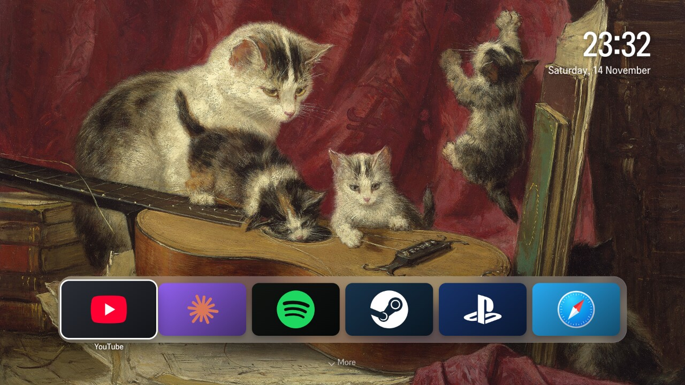
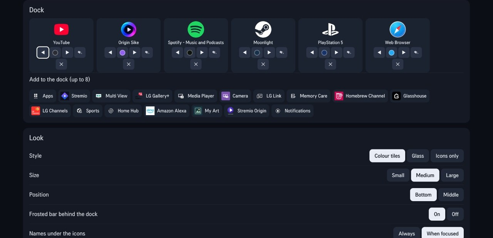

# Glasshouse Dock

A clean, Apple TV–style Home screen for rooted LG webOS TVs, made to run on top of [Glasshouse](https://github.com/rorygallagher2024/glasshouse).

One row of big app tiles over a full-screen picture, a clock and the weather if you want them, and nothing else. Everything is set from the TV remote or from your phone.



| Liquid glass: white icons, nothing else | Paintings gallery, with title and painter |
|---|---|
|  |  |

| Glass, clock in the middle, weather | Icons only, gradient background |
|---|---|
|  |  |

| Down: Settings, All apps, LG Home | Settings, on the TV or a phone |
|---|---|
|  |  |

## What it does

**The dock**
- Up to 8 apps **or HDMI inputs** (a PS5, a PC), in any order
- Four styles: **colour tiles**, **glass**, **liquid glass** (white icons straight on the picture) or **icons only**
- Each tile takes its app's own colour automatically, or one you pick
- Your own icon for any tile (a picture address or a file on the TV)
- Small, medium or large; at the bottom or in the middle; with or without the frosted bar; app names always, on focus, or never; the "More" hint on or off; your choice of focus colour

**Around it**
- **Clock**: 12 or 24 hour, seconds, date, five positions, four sizes
- **Weather**: current temperature, today's high and low, from [Open-Meteo](https://open-meteo.com) (free, no account, no key)
- **Greeting**: "Good morning", "Good evening"
- **Background**: 27 famous paintings that come with it (Van Gogh, Bruegel, Hokusai, Vermeer's era, cats...), one or a new one every 10 / 30 / 60 minutes, with the title in the corner if you like; or Glasshouse's wallpapers, your own picture, a colour or a gradient, darkened as much as you like

**Getting around**
- **Down**: Settings, All apps, LG Home
- **Back**: recent apps (OK opens, Down closes one)
- The Magic Remote's pointer works everywhere

**Starts first**
- **The TV turns on straight into the dock**, instead of LG's Home or whatever HDMI input was last used (no more console waking up through HDMI-CEC every time the TV turns on). Switch it to "Last used" in Settings for LG's normal behaviour.
- LG's Home can't be deleted (webOS needs it), but it never shows: the dock takes its place for the Home button and at power-on. "LG Home" stays one press away in the row under the dock.
- After a full power-off, root scripts start after LG's own start-up, so LG's Home may show for a few seconds before the dock takes over. With Quick Start+ on (the TV only sleeps), it should be quicker; not measured yet.
- Keeps Glasshouse's Home takeover running on TVs that refuse an optional Home-key notice (seen on webOS 11)

## Requirements

- An LG webOS TV **rooted** with the [Homebrew Channel](https://github.com/webosbrew/webos-homebrew-channel)
- [Glasshouse](https://github.com/rorygallagher2024/glasshouse) installed, with **Glasshouse Home** switched on in its dashboard
- Tested on an LG G4 (webOS 11.2) with Glasshouse 0.138. The code is plain ES5 like Glasshouse, so older TVs should work too; reports welcome.

## Install

**You need:** an LG TV rooted with the [Homebrew Channel](https://github.com/webosbrew/webos-homebrew-channel), and [Glasshouse](https://github.com/rorygallagher2024/glasshouse) installed.

1. **Turn on Glasshouse Home.** Open the Glasshouse dashboard (`http://<your-tv-ip>:8080` in a browser), go to **Home** and switch it on. Press Home on the remote to check that Glasshouse's Home shows.
2. **Open a terminal on the TV.** From a computer: `ssh root@<your-tv-ip>` (Homebrew Channel → Settings → enable SSH first). Or use the Homebrew Channel's own terminal.
3. **Paste this and press Enter:**
   ```sh
   curl -fsSL https://raw.githubusercontent.com/SikeXML/glasshouse-dock/main/install.sh | sh
   ```
4. **Press Home** on the remote. That's it.

**To set it up:** on the TV press **Down → Settings**, or on your phone open `http://<your-tv-ip>:8080/dock/settings` (same Wi-Fi). Changes show on the TV within a few seconds.

**To update:** run the same command again.

### Glasshouse updates

A Glasshouse update replaces its own files, including the Home page. Glasshouse Dock installs a boot script (`/var/lib/webosbrew/init.d/49-glasshouse-dock`) that puts the dock back at the next start-up, so after updating Glasshouse either restart the TV or run:

```sh
node /var/lib/tvweb/dock/apply.js && /var/lib/tvweb/tvwebctl restart
```

## Uninstall

```sh
sh /var/lib/tvweb/dock/uninstall.sh          # keeps your settings and pictures
sh /var/lib/tvweb/dock/uninstall.sh --purge  # removes them too
```

Glasshouse's own Home page and files are put back exactly as they were.

## What it changes

Everything lives in `/var/lib/tvweb/dock`. The installer then makes these changes, each undone by the uninstaller:

| File | Change |
|---|---|
| `/var/lib/tvweb/assets/home.html` | the dock's Home page (Glasshouse's is kept as `home.glasshouse.html`) |
| `/var/lib/tvweb/lib/dock.js` | the settings API (`/api/dock/*`, `/dock/settings`) |
| `/var/lib/tvweb/lib/routes.js` | one line that loads `dock.js` |
| `/var/lib/tvweb/lib/home.js` | an optional Home-key notice the TV refuses no longer ends the takeover |
| `/var/lib/webosbrew/init.d/*tvweb` | Glasshouse Home also opens at power-on when the TV starts on LG's Home |
| `/var/lib/tvweb/assets/home-app/index.html` | no fade-in (the dock draws its own start) |
| `/var/lib/webosbrew/init.d/49-glasshouse-dock` | re-applies the above after a Glasshouse update |

Nothing is sent anywhere except weather lookups (the city's position, to Open-Meteo), and only while weather is on.

## Credits and licence

Built on [Glasshouse](https://github.com/rorygallagher2024/glasshouse) by rorygallagher2024 (MIT), which does the hard part: taking over LG's Home, the app catalogue, icons, wallpapers and recent apps. Glasshouse Dock is an independent add-on and is not part of or endorsed by Glasshouse. Weather by [Open-Meteo](https://open-meteo.com) (CC BY 4.0). The paintings are public-domain works; each one, with its source, is listed in [gallery/CREDITS.md](gallery/CREDITS.md). The background in most screenshots is *Making Music* by Henriette Ronner-Knip.

MIT licence, see [LICENSE](LICENSE). LG and webOS are trademarks of LG Electronics; app names and icons belong to their owners.
