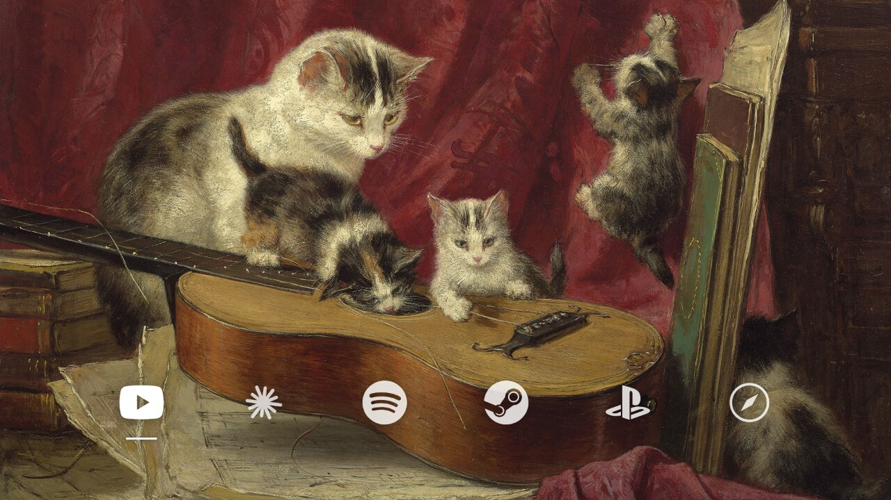
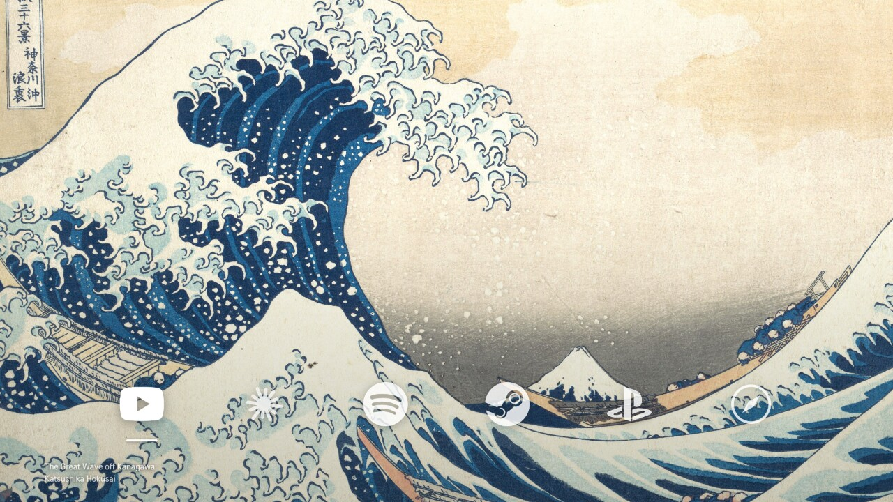
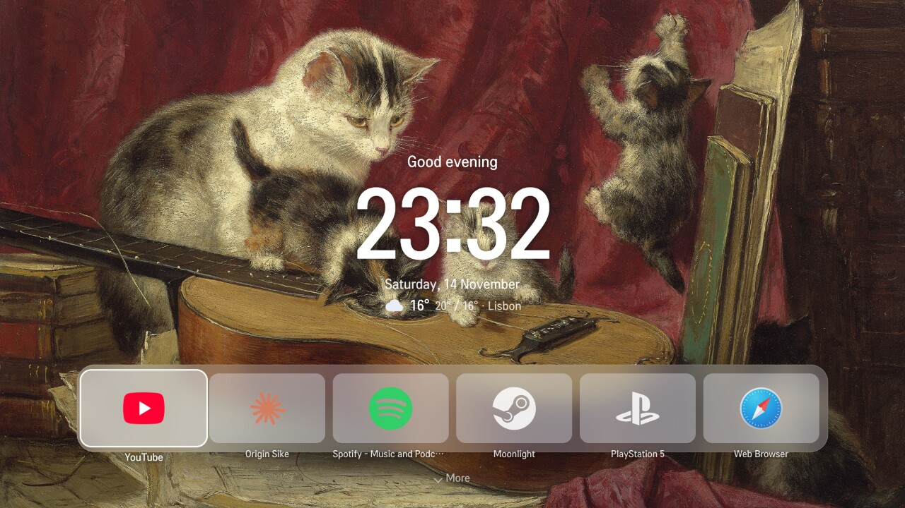
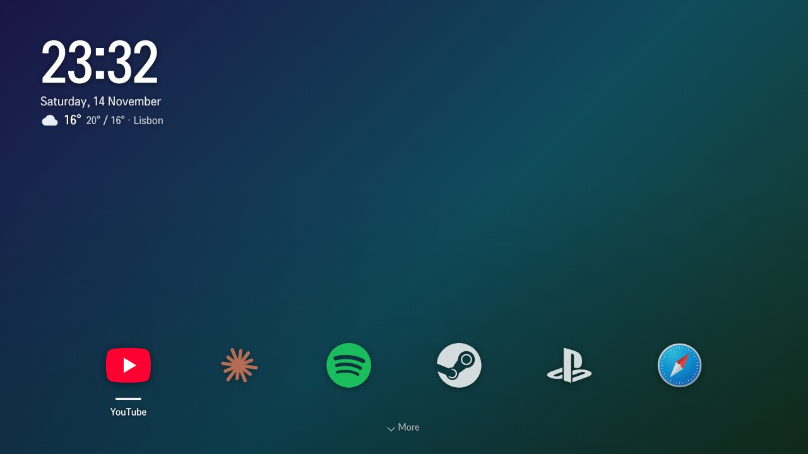
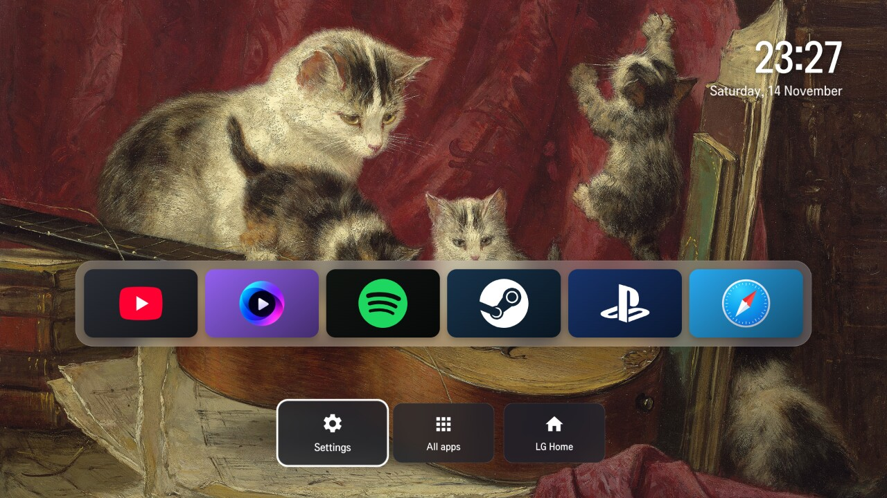
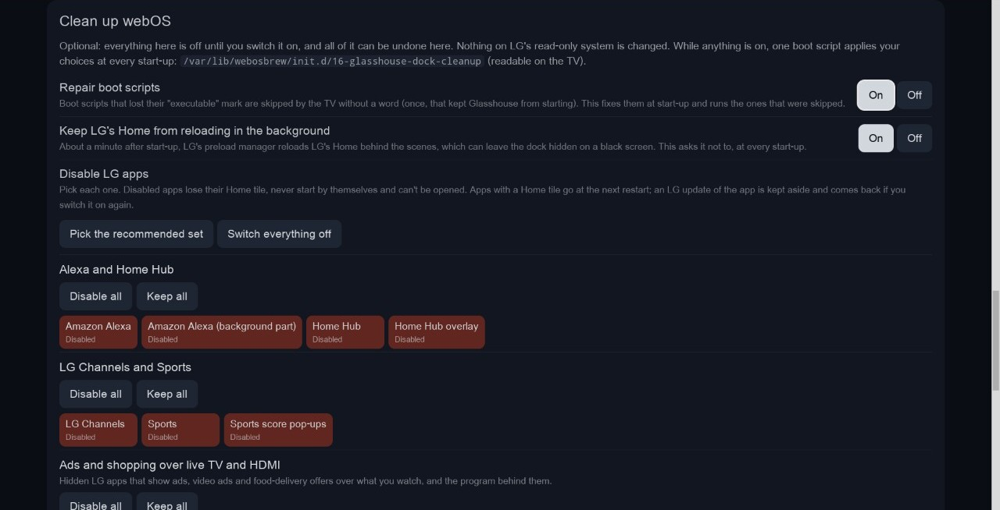

# Glasshouse Dock

A clean, Apple TV–style Home screen for rooted LG webOS TVs, made to run on top of [Glasshouse](https://github.com/rorygallagher2024/glasshouse).

One row of big app tiles over a full-screen picture, a clock and the weather if you want them, and nothing else. Everything is set from the TV remote or from your phone.


| Liquid glass: white icons, nothing else | Paintings gallery, with title and painter |
|---|---|
|  |  |

| Glass, clock in the middle, weather | Icons only, gradient background |
|---|---|
|  |  |

| Down: Settings, All apps, LG Home | Settings, on the TV or a phone |
|---|---|
|  |  |

## What it does

**The dock**
- Up to 8 apps **or HDMI inputs** (a PS5, a PC), in any order
- Four styles: **colour tiles**, **glass**, **liquid glass** (white icons straight on the picture) or **icons only**
- Each tile takes its app's own colour automatically, or one you pick
- Your own icon for any tile (a picture address or a file on the TV)
- Small, medium or large; at the bottom or in the middle; with or without the frosted bar; app names always, on focus, or never; the "More" hint on or off; your choice of focus colour

**Around it**
- **Clock**: 12 or 24 hour, seconds, date, five positions, four sizes
- **Weather**: current temperature, today's high and low, from [Open-Meteo](https://open-meteo.com) (free, no account, no key)
- **Greeting**: "Good morning", "Good evening"
- **Background**: 27 famous paintings that come with it (Van Gogh, Bruegel, Hokusai, Vermeer's era, cats...), one or a new one every 10 / 30 / 60 minutes, with the title in the corner if you like; or Glasshouse's wallpapers, your own picture, a colour or a gradient, darkened as much as you like

**Getting around**
- **Down**: Settings, All apps, LG Home
- **Back**: recent apps (OK opens, Down closes one)
- The Magic Remote's pointer works everywhere

**Starts first**
- **The TV turns on straight into the dock**, instead of LG's Home or whatever HDMI input was last used (no more console waking up through HDMI-CEC every time the TV turns on). Switch it to "Last used" in Settings for LG's normal behaviour.
- LG's Home can't be deleted (webOS needs it), but it never shows: the dock takes its place for the Home button and at power-on. "LG Home" stays one press away in the row under the dock.
- After a full power-off, root scripts start after LG's own start-up, so LG's Home may show for a few seconds before the dock takes over. With Quick Start+ on (the TV only sleeps), it should be quicker; not measured yet.
- Keeps Glasshouse's Home takeover running on TVs that refuse an optional Home-key notice (seen on webOS 11)
- **Brings the dock back if the screen goes empty.** After a full power-off, webOS restarts the part that runs web apps about a minute in, which can close the dock and leave a black screen. When the TV is on and nothing at all is showing for 20 seconds, the dock opens again. Apps, inputs and the screen saver are never interrupted. On by default, switch in Settings → Start-up. (New in 0.3.0: the black screen was seen and the recovery tested by hand, but the automatic one has not yet caught a real case.)

**Clean up webOS (optional, everything off until you choose)**
- **Disable LG apps you don't use**: Alexa, Home Hub, LG Channels, Sports, Camera, Multi View, LG Link, Gallery+, Tips and more, each one separately. They lose their Home tile, never start by themselves (LG's background preloading included) and can't be opened, not even by a remote button.
- **The hidden ad apps**: 20 apps LG uses to show ads, video ads and food-delivery offers over live TV and HDMI, and the ad program running in the background
- **Keep LG's Home from reloading in the background** (it can leave the dock hidden)
- **Repair boot scripts** that lost their "executable" mark, which makes the TV skip them without a word
- All from Settings, with each app's live state; everything undoes from there or with one command. See [Clean up webOS](#clean-up-webos-optional).

## Requirements

- An LG webOS TV **rooted** with the [Homebrew Channel](https://github.com/webosbrew/webos-homebrew-channel)
- [Glasshouse](https://github.com/rorygallagher2024/glasshouse) installed, with **Glasshouse Home** switched on in its dashboard
- Tested on an LG G4 (webOS 11.2) with Glasshouse 0.138. The code is plain ES5 like Glasshouse, so older TVs should work too; reports welcome.

## Install

**You need:** an LG TV rooted with the [Homebrew Channel](https://github.com/webosbrew/webos-homebrew-channel), and [Glasshouse](https://github.com/rorygallagher2024/glasshouse) installed.

1. **Turn on Glasshouse Home.** Open the Glasshouse dashboard (`http://<your-tv-ip>:8080` in a browser), go to **Home** and switch it on. Press Home on the remote to check that Glasshouse's Home shows.
2. **Open a terminal on the TV.** From a computer: `ssh root@<your-tv-ip>` (Homebrew Channel → Settings → enable SSH first). Or use the Homebrew Channel's own terminal.
3. **Paste this and press Enter:**
   ```sh
   curl -fsSL https://raw.githubusercontent.com/SikeXML/glasshouse-dock/main/install.sh | sh
   ```
4. **Press Home** on the remote. That's it.

**To set it up:** on the TV press **Down → Settings**, or on your phone open `http://<your-tv-ip>:8080/dock/settings` (same Wi-Fi). Changes show on the TV within a few seconds.

**To update:** run the same command again.

**Clean up webOS** is off after installing. Switch on what you want in Settings → Clean up webOS, or install with the recommended set already on:
```sh
curl -fsSL https://raw.githubusercontent.com/SikeXML/glasshouse-dock/main/install.sh | sh -s -- --cleanup
```

### Glasshouse updates

A Glasshouse update replaces its own files, including the Home page. Glasshouse Dock installs a boot script (`/var/lib/webosbrew/init.d/49-glasshouse-dock`) that puts the dock back at the next start-up, so after updating Glasshouse either restart the TV or run:

```sh
node /var/lib/tvweb/dock/apply.js && /var/lib/tvweb/tvwebctl restart
```

## Clean up webOS (optional)



Everything here is **off until you switch it on**, in Settings → Clean up webOS (on the TV, or `http://<your-tv-ip>:8080/dock/settings#cleanup` on a phone). Each option and each app has its own switch, shows what it is doing right now, and undoes from the same place. Nothing on LG's read-only system is changed: a factory reset removes all of it.

| Option | What it does |
|---|---|
| **Repair boot scripts** | webOS Homebrew runs the boot scripts in `/var/lib/webosbrew/init.d` only if they are marked executable, and skips the others without a word. (This once kept Glasshouse from starting after an update.) At every start-up, any that lost the mark get it back, and the ones skipped are run. |
| **Keep LG's Home from reloading in the background** | LG's preload manager reloads LG's Home behind the scenes after start-up, which can leave the dock hidden. It is asked not to, and checked every 10 seconds while Glasshouse runs, as LG forgets this at every start (and, on some TVs, every switch-on). |
| **Disable LG apps** | Each app you pick. Apps not on your TV are shown as such and skipped. The TV's essentials (Settings, inputs, Live TV, Home, the app store, software update, the keyboard...) are never offered and are refused even if asked. |

**How an app is disabled** (from `cleanup/hook.sh`, where each step is written out):
- **Apps with a Home tile, or ones LG updated through its store** (Alexa, Home Hub, LG Channels, Sports, Camera, Multi View, LG Link, Gallery+): webOS reads a writable system-app folder, `/media/system/apps/usr/palm/applications`, at start-up, before it builds any tile, and a copy there replaces the built-in one. The cleanup puts a hidden copy of the app there whose only page closes itself. So: no tile, never started, opening it (even from a remote button) does nothing. This takes effect **from the next restart**. If LG had updated the app, its update is moved to `/media/system/dock-cleanup-saved` and comes back when you switch the app on again.
- **Apps without a tile** (the ad overlays, Tips, Calendar, Music...): webOS blocks them (`blockSystemApp`), and their files are covered with that same closing page until the next restart.
- **Programs** (the ad overlay service): `/usr/sbin/adoverlay-service` is replaced, until the next restart, by one that does nothing.
- **LG's preload manager** is kept off the disabled apps: they are set to `false` in its allow list (`/var/preferences/webos-preload-manager-conf.json`, read when it starts), and only the entries set here are put back.

While at least one option is on, one boot script applies them at every start-up: `/var/lib/webosbrew/init.d/16-glasshouse-dock-cleanup` (a copy of [`cleanup/hook.sh`](cleanup/hook.sh), plain shell, readable on the TV). It restarts nothing, so there is no flicker. With everything off, it is deleted. Its log is `/tmp/glasshouse-dock-cleanup.log`.

**From the command line** (SSH):
```sh
sh /var/lib/tvweb/dock/cleanup/restore com.webos.app.lgchannels   # bring one app back
sh /var/lib/tvweb/dock/cleanup/restore --all                      # bring every app back
sh /var/lib/tvweb/dock/cleanup/restore --uninstall                # every app back, every option off, boot script removed
```
Your choices are in `/var/lib/tvweb/dock/cleanup/options.json`.

**Needs** `python3` on the TV for disabling apps (the other two options work without it). Tested on an LG G4 with webOS 11.2. On a TV without the writable system-app folder, apps with a tile can't be hidden; they are covered and closed instead. Reports from other models are welcome.

## Uninstall

```sh
sh /var/lib/tvweb/dock/uninstall.sh          # keeps your settings and pictures
sh /var/lib/tvweb/dock/uninstall.sh --purge  # removes them too
```

Glasshouse's own Home page and files are put back exactly as they were, and Clean up webOS is undone first (every app back, its boot script removed). Apps that had a Home tile come back after the next restart.

## What it changes

Everything lives in `/var/lib/tvweb/dock`. The installer then makes these changes, each undone by the uninstaller:

| File | Change |
|---|---|
| `/var/lib/tvweb/assets/home.html` | the dock's Home page (Glasshouse's is kept as `home.glasshouse.html`) |
| `/var/lib/tvweb/lib/dock.js` | the settings API (`/api/dock/*`, `/dock/settings`) |
| `/var/lib/tvweb/lib/routes.js` | one line that loads `dock.js` |
| `/var/lib/tvweb/lib/home.js` | an optional Home-key notice the TV refuses no longer ends the takeover |
| `/var/lib/webosbrew/init.d/*tvweb` | Glasshouse Home also opens at power-on when the TV starts on LG's Home |
| `/var/lib/tvweb/assets/home-app/index.html` | no fade-in (the dock draws its own start) |
| `/var/lib/webosbrew/init.d/49-glasshouse-dock` | re-applies the above after a Glasshouse update |
| `/var/lib/webosbrew/init.d/16-glasshouse-dock-cleanup` | only while a Clean up webOS option is on: applies your choices at start-up |
| `/media/system/apps/usr/palm/applications/<app>` | only for apps you disabled that have a Home tile: the hidden copy (LG's update, if any, kept in `/media/system/dock-cleanup-saved`) |
| `/var/preferences/webos-preload-manager-conf.json` | only for apps you disabled: set to `false` in LG's preload allow list |

The dock's own server (`server/dock.js`, `server/cleanup.js`) also, while Glasshouse runs: keeps the TV from starting on an HDMI input (Start-up → Dock), brings the dock back when the screen is left empty (Start-up), and keeps LG's preload manager off LG's Home and the disabled apps (Clean up webOS). Each has its switch in Settings.

Nothing is sent anywhere except weather lookups (the city's position, to Open-Meteo), and only while weather is on.

## Credits and licence

Built on [Glasshouse](https://github.com/rorygallagher2024/glasshouse) by rorygallagher2024 (MIT), which does the hard part: taking over LG's Home, the app catalogue, icons, wallpapers and recent apps. Glasshouse Dock is an independent add-on and is not part of or endorsed by Glasshouse. Weather by [Open-Meteo](https://open-meteo.com) (CC BY 4.0). The paintings are public-domain works; each one, with its source, is listed in [gallery/CREDITS.md](gallery/CREDITS.md). The background in most screenshots is *Making Music* by Henriette Ronner-Knip.

MIT licence, see [LICENSE](LICENSE). LG and webOS are trademarks of LG Electronics; app names and icons belong to their owners.
